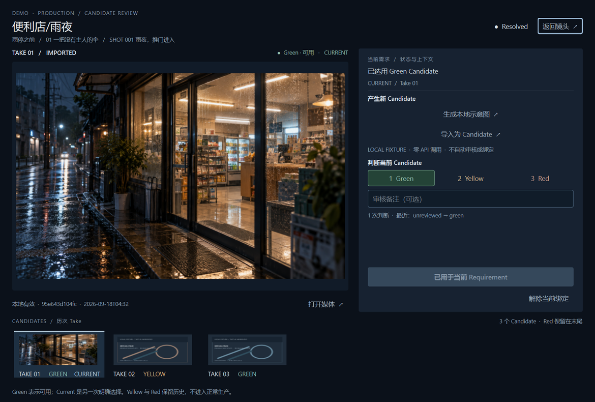

# AI 视频个人生产工作流 · V0.2

> 长期维护、代码入口、Truth、测试与发布导航请从 [AIGCFlow Project Map V0.1](docs/PROJECT_MAP.md) 开始。以下早期 C/Preparation 说明保留为历史使用资料；当前默认入口是 D Shell，实际 RC1 状态以项目地图及代码为准。

当前交付：**V0.2 准备工作区 + Production / Candidate / Review 最小完整闭环**。C「镜头上下文」仍是正式视觉基线。

规范剧本 → 资产需求 → 缺失项生产 / 导入 → Candidate → Green / Yellow / Red → 明确选用 Current → Requirement Resolved。

正式依据为 `重要文档` 中的项目定义 V0.2、项目路线 V0.2、AI 协作规则 V0.1。旧 A-01～A-08 / UI-Final 是技术底座与历史证据，不定义当前产品结构。

## 启动

```powershell
python -m pip install -r requirements.txt
python -m app.preparation_gui
```

或双击 `start.cmd`。使用 Python 3.11+、PySide6 6.10.2，以及 PATH 中已有的 FFmpeg 工具（音视频参照校验使用 ffprobe）。

首次进入空工作区：在右侧点“编辑剧本”、从顶栏导入 `.md/.txt` 规范剧本，或点底栏“打开示例”。“打开项目”可选择新空文件夹或已有 V0.2 项目。

默认启动恢复上次打开的项目；指定项目：

```powershell
python -m app.preparation_gui --data-dir evidence/V0.2-C-Qt/demo-project
```




## 当前可用

- 影片 → 章节 → 镜头，支持多人物、完整视觉组合、独立 Voice、环境/背景音、关键物件、视频镜头参照和自然语言创作区。
- 剧本自动推导并去重资产需求；无需手工建立资产清单。
- 已有、缺失、歧义、变更状态；明确选择、导入自动命名、图片与音视频预览。
- 开放素材文件夹；新增、替换、改名、删除后重新扫描，提示受影响镜头。
- 草稿自动保存、源行错误定位、有效版本保护、资产历史与绑定恢复。
- 章节/镜头和编辑位置恢复，同项目单窗口写入。
- 缺失需求可进入 Production：图像使用零调用本地 Fixture，图像 / 音频 / 视频均可导入为 Candidate。
- Candidate 独立保留 Take、媒体哈希、来源、Job、审核与绑定历史；多个 Green 可共存，Current 需另行明确选用。

准备就绪仅表示必需参照已映射，不表示模型质量或成片完成。当前图像 Fixture 不调用真实 API；轻剪和输出仍在后续轮次接入。

## 日常操作

1. 在右侧阅读当前镜头剧本；点“编辑剧本”修改，或从顶栏导入，然后点“应用剧本”（Ctrl+Enter）。草稿自动保存，Ctrl+S 可立即保存。
2. 顶部切换章节、底部切换镜头；左侧缺失需求直接选择“不需要固定素材 / 导入素材 / 添加 API”。
3. 不需要固定素材会保留需求语义、解除固定参照阻塞，可随时恢复；导入则进入现有 Candidate → Green / Yellow / Red → 明确选用 Current 链。
4. “添加 API”定位到对应的 Image / Audio / Video 能力；当前无真实内部 Provider，明确显示未配置。返回镜头后，素材变化可点“同步素材”，不会静默改绑。
5. 关闭重开继续当前项目；迁移时复制整个项目目录，包含 `.history`。

[五分钟语法、文件夹约定与实现边界](docs/V0.2-准备工作区.md) · [C 母版 Qt 实现与截图](evidence/V0.2-C-Qt/实现回执.md) · [Production 施工回执与截图](evidence/V0.2-Production/施工回执.md) · [Missing Resolution 回执与截图](evidence/V0.2-Missing/施工回执.md)

## 工程入口

```text
app/preparation/script.py       Parser、章节镜头、资产需求与源行
app/preparation/workspace.py    映射、文件同步、版本、历史、原子状态
app/preparation/visuals.py      统一视觉语言、剧本编辑器
app/preparation/production.py   Job、Candidate、审核与明确绑定
app/preparation/production_gui.py  Qt 生产与判断工作区
app/preparation/example.py      示例剧本、原创矢量与 AI 生成的 Demo 环境参照
app/preparation_gui.py          Qt 准备工作区与参照预览
workspace-v02/                  默认新工作区（运行数据，不提交 Git）
```

新工作区没有迁移或覆盖旧 `data`。历史 Tk GUI 与生成模块仍在仓库，供后续按能力提取复用；不承担旧 GUI 兼容要求。

## 本轮聚焦验证

```powershell
python -m unittest tests.test_missing_resolution tests.test_preparation_production tests.test_preparation_gui tests.test_preparation -v
```

聚焦验证 Missing 决策、Candidate 生命周期、绑定与恢复、代表性 Qt 主路径和 Workspace 受影响逻辑；未重复历史生成、FFmpeg、OTIO 的大规模回归。

Missing Requirement Resolution 施工基线：`8979715`。无远程仓库配置或发布动作。
