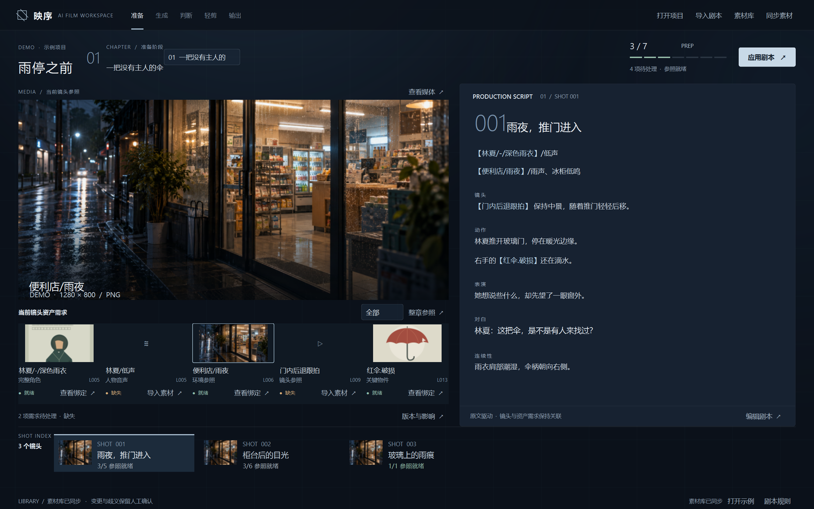

# AI 视频个人生产工作流 · V0.2

当前交付：**剧本驱动准备闭环 + 已通过 C「镜头上下文」母版的真实 Qt 工作区**。

规范剧本 → 解析 → 资产需求 → 扫描素材库 → 导入 / 明确绑定 → 章节 Ready。

正式依据为 `重要文档` 中的项目定义 V0.2、项目路线 V0.2、AI 协作规则 V0.1。旧 A-01～A-08 / UI-Final 是技术底座与历史证据，不定义当前产品结构。

## 启动

```powershell
python -m pip install -r requirements.txt
python -m app.preparation_gui
```

或双击 `start.cmd`。使用 Python 3.11+、PySide6 6.10.2，以及 PATH 中已有的 FFmpeg 工具（音视频参照校验使用 ffprobe）。

首次进入空工作区：在右侧点“编辑剧本”、从顶栏导入 `.md/.txt` 规范剧本，或点底栏“打开示例”。“打开项目”可选择新空文件夹或已有 V0.2 项目。

默认启动恢复上次打开的项目；指定项目：

```powershell
python -m app.preparation_gui --data-dir evidence/V0.2-C-Qt/demo-project
```



## 当前可用

- 影片 → 章节 → 镜头，支持多人物、完整视觉组合、独立 Voice、环境/背景音、关键物件、视频镜头参照和自然语言创作区。
- 剧本自动推导并去重资产需求；无需手工建立资产清单。
- 已有、缺失、歧义、变更状态；明确选择、导入自动命名、图片与音视频预览。
- 开放素材文件夹；新增、替换、改名、删除后重新扫描，提示受影响镜头。
- 草稿自动保存、源行错误定位、有效版本保护、资产历史与绑定恢复。
- 章节/镜头和编辑位置恢复，同项目单窗口写入。

准备就绪仅表示必需参照已映射，不表示模型质量或成片完成。新主链的生成、红黄绿审核、轻剪和输出将在后续轮次接入；本轮未调用真实 API。

## 日常操作

1. 在右侧阅读当前镜头剧本；点“编辑剧本”修改，或从顶栏导入，然后点“应用剧本”（Ctrl+Enter）。草稿自动保存，Ctrl+S 可立即保存。
2. 顶部切换章节、底部切换镜头；左侧查看真实媒体及当前镜头资产需求，点“导入素材”或“查看绑定”。
3. 同名多候选时明确选择；外部替换文件后确认新版本。不会静默改绑。
4. 外部增删或改名后点“同步素材”，通过“变更记录与影响定位”返回相关镜头。
5. 关闭重开继续当前项目；迁移时复制整个项目目录，包含 `.history`。

[五分钟语法、文件夹约定与实现边界](docs/V0.2-准备工作区.md) · [C 母版 Qt 实现与截图](evidence/V0.2-C-Qt/实现回执.md) · [本轮施工回执](evidence/V0.2-R1/施工回执.md)

## 工程入口

```text
app/preparation/script.py       Parser、章节镜头、资产需求与源行
app/preparation/workspace.py    映射、文件同步、版本、历史、原子状态
app/preparation/visuals.py      统一视觉语言、剧本编辑器
app/preparation/example.py      示例剧本、原创矢量与 AI 生成的 Demo 环境参照
app/preparation_gui.py          Qt 准备工作区与参照预览
workspace-v02/                  默认新工作区（运行数据，不提交 Git）
```

新工作区没有迁移或覆盖旧 `data`。历史 Tk GUI 与生成模块仍在仓库，供后续按能力提取复用；不承担旧 GUI 兼容要求。

## 本轮聚焦验证

```powershell
python -m unittest discover -s tests -p 'test_preparation*.py' -v
```

本次 C 母版 Qt 施工只聚焦代表性 GUI 主路径与实际窗口截图；Parser、FFmpeg、OTIO 等未修改能力没有重复大规模回归。

施工前 Git 基线：`0af6a85`。无远程仓库配置或发布动作。
