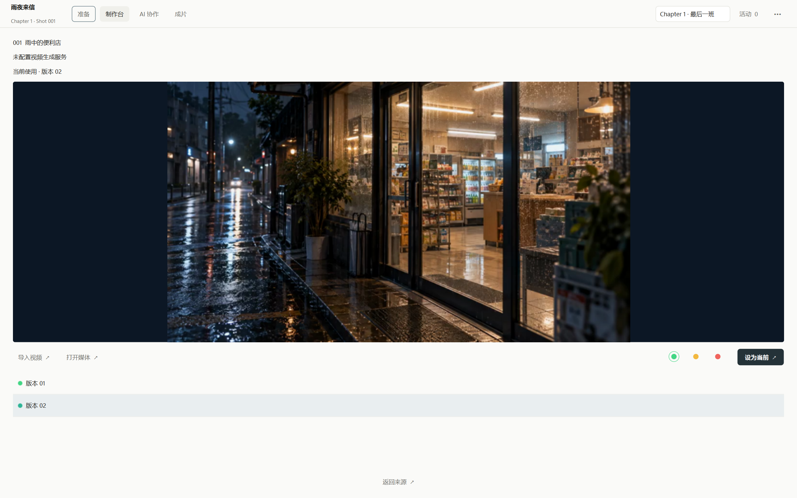
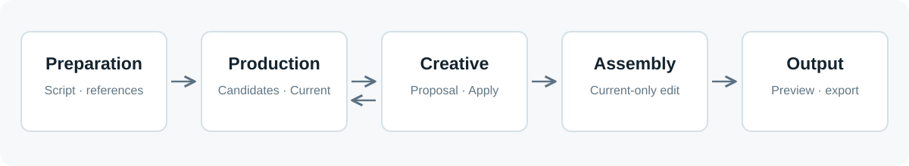
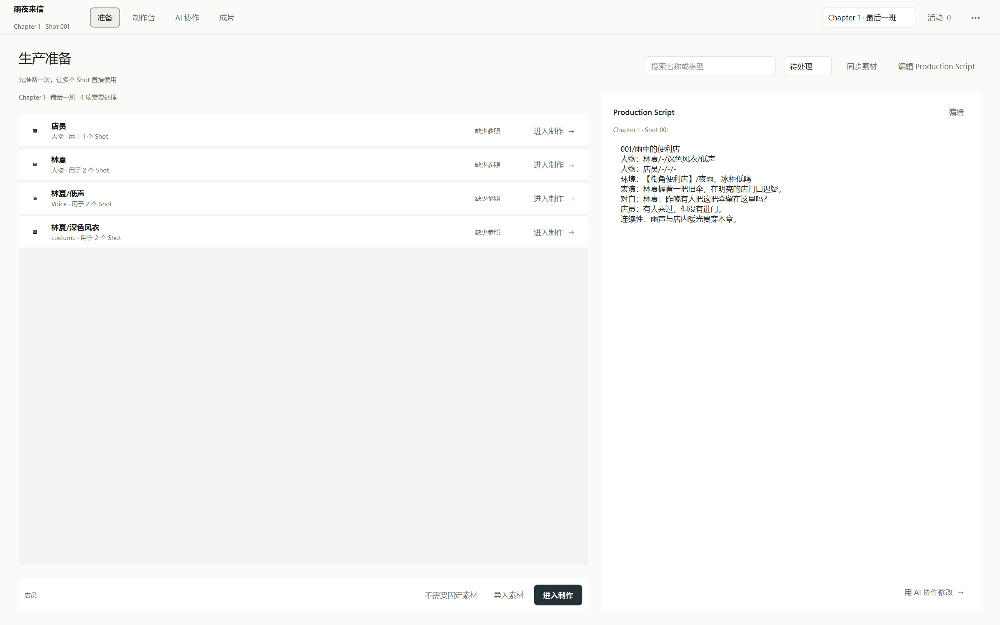
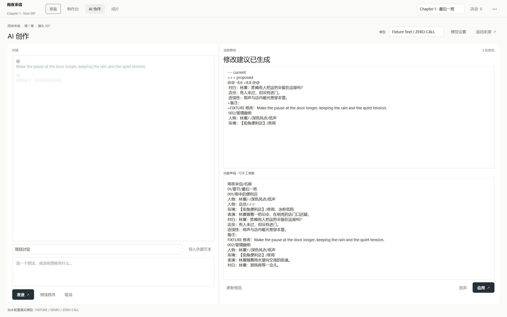
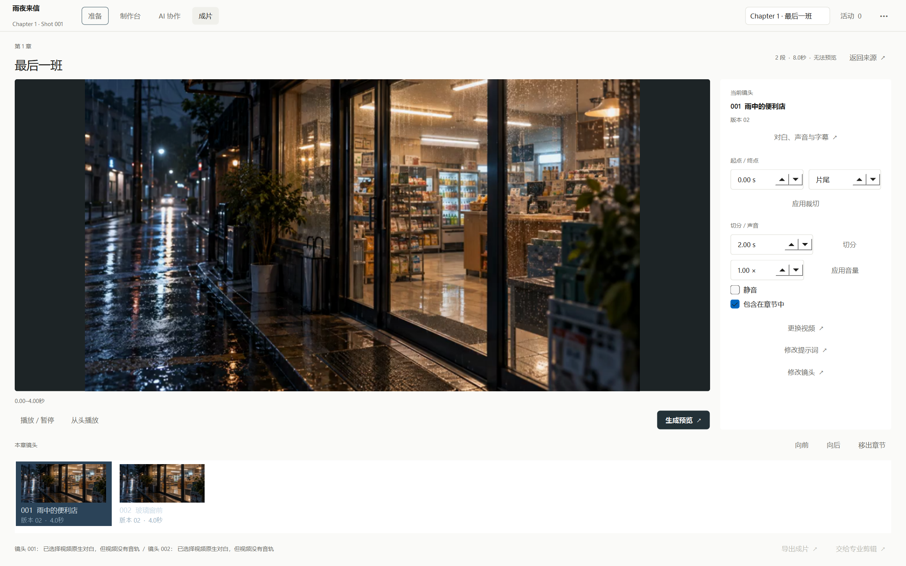

# AI Video Flow

An open-source AI video production workflow for Windows. It organizes preparation, generation, review, creative revision, and assembly in one desktop application—not a one-prompt video generator.



*The current D-layout Production workspace, captured from a disposable synthetic demo project. The selected clip was made locally from the bundled demo scene image; another Candidate came from the zero-call fixture. Neither is a commercial model result.*

## What it is

AI generation is one stage in a longer production process. AI Video Flow helps you keep the script, shared references, generated takes, human review, chosen take, creative changes, and output connected across shots and chapters.

**Preparation → Production ↔ Creative → Assembly → Output**



- **Preparation:** derive shared asset requirements from a structured script, import references, and resolve missing inputs.
- **Production:** run supported jobs, retain Candidates, review them, then explicitly bind a Current take. Green review alone does not select a take.
- **Creative:** discuss a shot or project, inspect a Proposal and Diff, edit a draft, and explicitly Apply a valid revision to the production script.
- **Assembly:** consume Current media for chapter editing, preview/output, and OpenTimelineIO handoff. A shot without Current remains visibly unresolved.

The [Project Map](docs/PROJECT_MAP.md) is the entry point for architecture, data ownership, runtime, tests, and the release flow.

## Screenshots

These are captures of the current PySide6 D layout using one temporary, public-safe demo project. The scene clip was imported from local media; the other Candidate and Creative text use zero-call fixtures. No commercial provider was called.

| Preparation | Creative |
| --- | --- |
|  |  |



## Current status

**v0.1.0-rc.1 is a Windows-first release candidate.** The D-layout application, project workflow, local fixture providers, Windows Installer, and portable ZIP have passed local release-gate tests. This is not a claim that commercial image or video generation is integrated.

The default image, audio, and video providers are **zero-call local fixtures**. Creative text can optionally use a configurable OpenAI-compatible API; its key is read from an environment variable, not saved in project settings. The archived `fal_adapter.py` and integration harness are not registered as production media providers in the D runtime.

Current limits: the Windows builds are unsigned and may trigger a SmartScreen warning; no automatic updater or credential store is included; cross-version project migration is not yet a supported workflow. Keep a backup of important projects before trying an RC. See the [release notes](docs/releases/v0.1.0-rc.1.md) for more detail.

## Install on Windows

The release artifacts are prepared locally; they will be attached to the GitHub pre-release when publication is approved. Verify downloads against the accompanying `SHA256SUMS.txt`.

- **Installer:** download `AI-Video-Flow-0.1.0-rc.1-windows-x64-setup.exe`, run it, and follow the per-user setup wizard. It adds a Start Menu shortcut; the desktop shortcut is optional. Uninstalling the app does not delete projects.
- **Portable:** download `AI-Video-Flow-0.1.0-rc.1-windows-x64.zip`, extract it, and run `AIVideoFlow.exe`. Keep the extracted files together.

Both contain FFmpeg/FFprobe for local media work. Their third-party terms are documented in [Third-Party Notices](THIRD_PARTY_NOTICES.md). The legacy user-data location remains `%LOCALAPPDATA%\AI Video Workflow` for compatibility; this is distinct from the installation directory.

## Run from source

Use Windows, Python 3.11 or newer, and FFmpeg/FFprobe on `PATH` for media operations. From the repository root:

```powershell
python -m pip install -r requirements.txt
python -m app.preparation_gui
```

The default layout is D; `--layout C` opens the older Preparation layout. To work with a separate project, pass `--data-dir <folder>`. The app does not need Node for ordinary GUI use.

## Build and test

The Windows portable and Installer builds are scripted in `scripts/build_windows.ps1` and `scripts/build_windows_installer.ps1`. Build prerequisites, clean-runtime, ZIP, install/uninstall, and checksum gates are in [Releasing](docs/RELEASING.md). Generated `build/`, `dist/`, and `release/` binaries are not committed to the source repository.

```powershell
$env:QT_QPA_PLATFORM = 'offscreen'
python -m unittest discover -s tests -q
```

See [Testing](docs/TESTING.md) for targeted suites and fixture boundaries. The latest local release-gate evidence is under `evidence/V0.1-Windows-Installer/`; it is not an online-provider test.

## Contributing and license

Start with [Contributing](CONTRIBUTING.md) and the [Project Map](docs/PROJECT_MAP.md) before changing a truth boundary. Report security concerns through the guidance in [Security](SECURITY.md), not a public issue containing secrets.

The project's own code is licensed under [Apache-2.0](LICENSE). Bundled dependencies have separate licenses and obligations; see [Third-Party Notices](THIRD_PARTY_NOTICES.md). Public release readiness is tracked in the [audit](docs/PUBLIC_RELEASE_AUDIT_V0.1.md).
