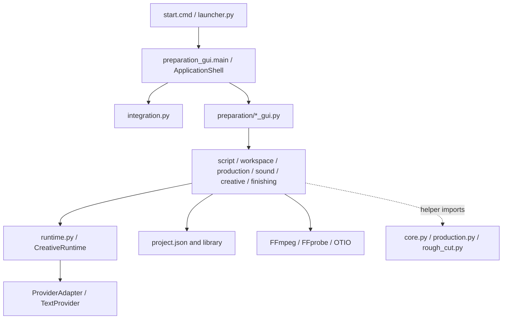

# Architecture — 当前代码边界

[返回 Project Map](PROJECT_MAP.md) · 状态：RC1 `CURRENT`，不是目标架构提案。

## 层与依赖方向

实际 package 是 `app/`，不是按图机械分层。`app/preparation/` 同时包含领域服务与 Workspace UI；跨文件 import 必须以代码为准。`app/core.py` 的原子 JSON 写入等工具、`app/production.py` 的媒体工具调用、`app/rough_cut.py` 的探测仍被新服务复用；`app/gui.py` 和旧 `fal_adapter.py` 等保留 legacy/兼容或独立路径，不是 D Shell 的正式领域 owner。旧 `integrations/`、`tests/test_harness.py` 的 Node/DSH 桥接是特定集成验证，不等于默认生成 Provider。

## Shell、Workspace 与路由

源码 `start.cmd` 和 `packaging/windows/launcher.py` 均进入 `app.preparation_gui.main()`；它从 `AppSettingsStore` 取默认 D 布局，D 时创建 `app.integrated_gui.ApplicationShell`，C 时创建 `PreparationWindow`。D Shell 仍构造隐藏的 `PreparationWindow` 复用项目装载、扫描/锁定和草稿生命周期。Shell 是 presentation/integration，不拥有 Script、Candidate 或 Assembly Truth。

`app/integration.py:WorkspaceRouter` 将 project-scoped `route`、`last_workspace`、各 Workspace `memory`、`return_stack` 存入 `project.json` 的 `ui.integration_v1`。`Route` 携带 project/chapter/shot/object target、origin、reason；`ReturnPoint` 额外保留 selection/scroll/panel/tab/playhead。深链进入 B 时压入 A 的 return point；`return_to_origin()` 恢复 A；失效章节/镜头由 `resolve()` 安全降级；无正式剧本时 Production/Assembly 降级 Preparation。Settings 可导航但不计入日常 `WORKSPACES`。项目状态不是全局 Session；跨项目由入口的 `session-v1.json` 恢复上次项目。

`ActivityAdapter` 只聚合既有 runtime_jobs、creative_runs 和 assembly 输出记录，不创建 Job 或自动跳页。后台任务完成不应抢走用户当前路由；页面可隐藏，但工作者/项目锁与关闭时机仍由现有 GUI 生命周期约束。见 [Runtime](RUNTIME.md)。

## Product Workspace 与领域边界

| Workspace | 主要 UI | 领域 owner / 消费关系 |
| --- | --- | --- |
| Preparation | `app/preparation_gui.py`、D Preparation page | `preparation/script.py` parser、`workspace.py:Workspace`；声明需求、扫描素材 |
| Production | `preparation/production_gui.py`、`production_runtime_gui.py` | `production.py:ProductionService`、`runtime.py:ProductionRuntime`；Candidate/Review/Current |
| Creative | `preparation/creative_gui.py` | `creative.py:CreativeService/CreativeRuntime`；Proposal，Apply 经 Workspace |
| Assembly | `preparation/finishing_gui.py` | `finishing.py:ChapterFinishing` 消费 Current；`sound.py:SoundProduction` 音频计划 |
| Settings | `integrated_gui.py:SettingsPage` | `integration.py:AppSettingsStore` 本机设置，不写 Project Truth |

Production 是日常核心生产地面，Preparation 管共享 Requirement/Asset，Creative 是受控改写剧本的协作区，Assembly 只派生输出。输出不是第六份 Production Truth。

## 健康依赖与已知债务

健康的主方向：UI 调服务，服务读写项目状态；Provider 只执行请求并回结果；Assembly 向 Production 查询 Current，不回写 Current；Shell/Activity 观察与导航，不接管 Job。测试没有要求物理目录完全隔离。

已知审计裁决是 **SMALL REFACTOR**，不是结构性重写，三项仅 `PLANNED`：

1. `ProjectRepository / Migration`：当前 `Workspace` 直接装载/补默认/写 `project.json`，可用，但未来版本兼容和回滚没有稳定政策。计划把版本读写、备份事务、迁移边界抽出；本轮未实施。
2. `ProjectSession`：当前隐藏 `PreparationWindow` 还承担非视觉项目会话职责；运行正常，但影响 Shell/后台生命周期的可替换性。计划抽出项目装载、锁、扫描/保存等非视觉职责；本轮未实施。
3. `Media / IO primitives`：FFmpeg/FFprobe 查找、执行、校验散在新旧模块；打包与升级时需跨层追踪。计划收拢共用原语，不改用户可见语义；本轮未实施。

`DEFERRED`：Installer、Updater、CI/CD、Credential Store。没有这些能力时，不能在新 UI 或文档里假装已有自动升级、自动发布或安全凭据库。

## 维护依赖检查

改领域字段时先查 [Data Model](DATA_MODEL.md) 的 owner/落盘，再看本图 UI 消费；改 Provider/任务看 [Runtime](RUNTIME.md)；改路由/页面看 [Testing](TESTING.md) 的 Shell/GUI 定向集。纯视觉状态刷新不能引起不必要的媒体重建；纯视觉样式修改应保持冻结 D 几何。
