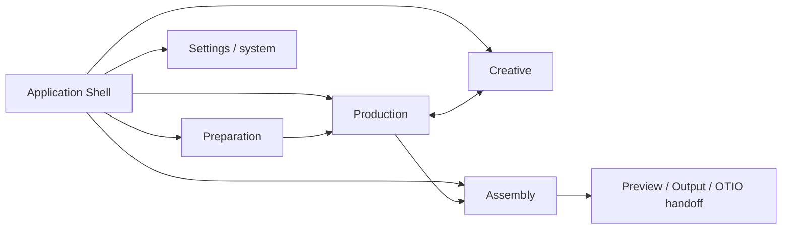
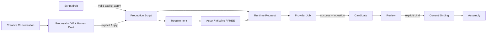
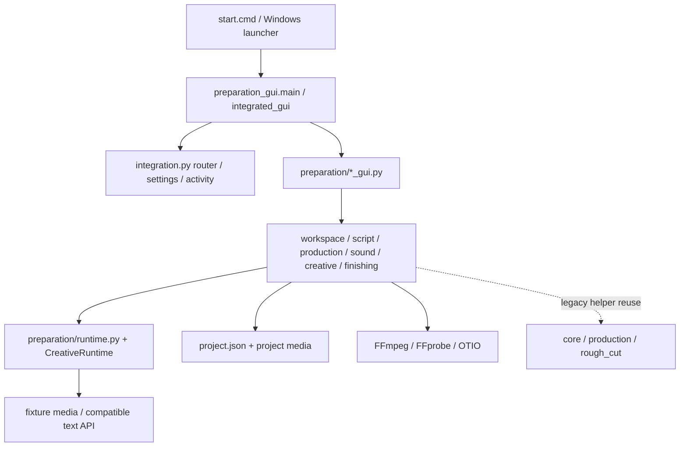

# AI Video Flow Project Map V0.1

> 原工程名 AIGCFlow；原始测绘基线 `9d4ce5a`，发行层已更新至 Windows Installer V0.1。以实际 Git HEAD 为准。`CURRENT` 是已实现，`PLANNED`/`DEFERRED` 不是已交付能力。

## 30 秒心智模型

`project.json` 是项目状态容器；正式 Production Script 声明需求，Preparation 管素材，Production 产生并审核 Candidate，显式 Current Binding 决定 Assembly 能消费什么。Creative 的 Proposal 只有经过显式 Apply 才改正式剧本。D Shell 负责导航和观察，不替业务服务拥有 Truth。Windows RC 同时提供 per-user Installer 与 portable ZIP。

Workspace 是产品视角，不等于同名 Python module。Production 是日常核心生产地面。`app/preparation_gui.py:main` 是源码与 portable 启动入口；默认 Settings `layout=D` 创建 `app/integrated_gui.py:ApplicationShell`，`--layout C` 可进旧 Preparation 界面。Shell 内保留隐藏的 `PreparationWindow` 以复用现有项目生命周期；不要把隐藏窗口当成第二份项目 Truth。

| Workspace | 输入 → 输出 | UI state / 不拥有的 Truth |
| --- | --- | --- |
| Preparation | 剧本草稿、文件 → 正式剧本、需求、素材、引用决策 | 编辑选择等视图状态；不拥有 Candidate/Current |
| Production | 正式剧本、需求、素材 → Request/Job、Candidate、Review、Current | 选中镜头/候选；Selected 不等于 Current |
| Creative | 正式剧本、对话 → Proposal/Diff/Human Draft；Apply 后更新剧本 | 会话视图；Proposal 本身不是正式剧本 |
| Assembly | 正式镜头序列及 Current → 编辑、预览、输出、OTIO | playhead/面板；不修改 Production Current |
| Settings | 系统偏好、文本 Provider 配置 → 本机设置 | 系统层；Global Default 不是项目 Truth |

## 核心 Truth 与数据流

`Green ≠ Current`；`Selected ≠ Current`；`FREE ≠ Asset`；`Proposal ≠ Production Truth`。Failed Job 不生成 Candidate；Missing 是可处理状态；Stale 不等于删除；Assembly 只消费 Current，缺 Current 的镜头仍保留序列位置。完整 owner、身份、落盘和 mutation 表见 [Data Model](DATA_MODEL.md)。

## 代码与运行地图

代码层、实际依赖与债务见 [Architecture](ARCHITECTURE.md)；Job、Provider、后台与媒体见 [Runtime](RUNTIME.md)。默认媒体 Provider 只有 image/audio/video 零调用 fixture；Creative 可使用 OpenAI-compatible 文本 API。旧 `fal_adapter.py`、Harness/DSH 桥接及测试存在，不代表媒体商业 Provider 已在 D Runtime 正式注册。

## 数据在哪里

默认项目根在 `%LOCALAPPDATA%/AI Video Workflow/Projects/workspace-v02`，可由入口 `--data-dir` 指定；正式状态主要写在 `<project>/project.json`，素材在 `library/{kind}`，历史快照在 `.history/media`，任务工作文件在 `production/runtime/{job-id}`，章节预览/成片/交接在 `finishing/{chapter-id}/{preview|output|handoff}/{fingerprint}`。系统设置是独立的 `%LOCALAPPDATA%/AI Video Workflow/settings-v1.json`，上次项目会话是 `session-v1.json`；路由记忆在项目 `ui.integration_v1`。路径以 [Data Model](DATA_MODEL.md) 为准。当前 schema 是 `preparation-0.2` 加 `setdefault` 补字段，**没有正式 migration/backup transaction/compatibility policy**。

## 从哪里开始

| 意图 | 先读 | 代码入口 |
| --- | --- | --- |
| 理解产品及冻结语义 | [正式项目定义](../重要文档/AI视频个人生产工作流_项目定义_V0.2_正式冻结版.md)、[正式路线](../重要文档/AI视频个人生产工作流_项目路线_V0.2_正式冻结版.md) | [`app/preparation/script.py`](../app/preparation/script.py) |
| 改 UI / Shell / Router | [Architecture](ARCHITECTURE.md) | [`app/integrated_gui.py`](../app/integrated_gui.py)、[`app/integration.py`](../app/integration.py)、`app/preparation/*_gui.py` |
| 改项目数据 / 身份 / Current | [Data Model](DATA_MODEL.md) | [`app/preparation/workspace.py`](../app/preparation/workspace.py)、`production.py` |
| 改 Provider / Job / 媒体 | [Runtime](RUNTIME.md) | [`app/preparation/runtime.py`](../app/preparation/runtime.py)、`creative.py`、`finishing.py` |
| 查回归影响 | [Testing](TESTING.md) | `tests/` |
| 构建与发布 | [Releasing](RELEASING.md) | [`scripts/build_windows.ps1`](../scripts/build_windows.ps1)、[`scripts/build_windows_installer.ps1`](../scripts/build_windows_installer.ps1) |

## Change Map：先定位再施工

每行均按 `Start Here / Likely Touch / Do Not Touch Unless Needed / Truth Boundary / Required Tests / Release Impact` 使用。测试简称对应 [Testing](TESTING.md) 的真实 `tests/test_*.py`。表中 `preparation/...`、`integration.py`、`integrated_gui.py` 等短路径相对 `app/`；`requirements.txt`、`scripts/...` 相对仓库根。`DNT` 是范围护栏，不是绝对禁令。

| Change | Start Here | Likely Touch | DNT | Truth Boundary | Required Tests | Impact |
| --- | --- | --- | --- | --- | --- | --- |
| 新 Image Provider | `preparation/runtime.py:default_registry` | adapter、ModelManifest | 剧本解析 | 输出需成功 ingest 后才成 Candidate | `test_production_runtime`, `test_preparation_production`, `test_images` | High |
| 新 Video Provider | `preparation/runtime.py:ProviderAdapter` | capability、worker、媒体验证 | Current 自动绑定 | Job success ≠ Current | `test_production_runtime`, `test_production_runtime_gui`, `test_chapter_finishing` | High |
| 新 Audio Provider | `preparation/runtime.py:default_registry` | `sound.py`、媒体探测 | Dialogue/Background 身份规则 | 对白/环境音 Current 独立 | `test_preparation_sound`, `test_preparation_sound_gui`, `test_production_runtime` | High |
| 改 Prompt 生成 | `preparation/prompt.py` | `runtime.py` 请求构造 | project schema | Prompt 是输入，非正式剧本 | `test_preparation_prompt`, `test_production_runtime` | Medium |
| 改 Candidate UI | `preparation/production_gui.py` | selection/marker | `production.py` 持久字段 | Selected ≠ Current | `test_preparation_production`, `test_production_runtime_gui`, `test_integration_shell` | Medium |
| 改 Review | `preparation/production.py:ProductionService` | Production UI | Assembly 编辑结构 | Green ≠ Current | `test_preparation_production`, `test_asset_rework`, `test_chapter_finishing` | High |
| 改 Current | `preparation/production.py` | `sound.py`、`finishing.py`、UI | 自动 Current | 显式绑定，Assembly Current-only | `test_preparation_production`, `test_preparation_sound`, `test_chapter_finishing`, `test_integration_shell` | High |
| 改 Script schema | `preparation/script.py` | parser、Workspace.apply、Creative scope | 直接改 JSON | 正式剧本只经有效 Apply | `test_preparation`, `test_preparation_creative`, `test_integration_shell` | High |
| 改 Project schema / 新 Project field | `preparation/workspace.py:Workspace` | 读写、兼容样本、session | 只加 `setdefault` 就宣称 migration | `project.json` 正式项目状态 | `test_preparation`, `test_integration_shell`, `test_packaging` | High |
| 改 Preparation UI | `preparation_gui.py` | `integrated_gui.py` D page | parser 语义 | UI 不重定义正式剧本 | `test_preparation_gui`, `test_ui_final`, `test_integration_shell` | Medium |
| 改 Production UI | `preparation/production_gui.py` | D Shell 嵌入 | Runtime 状态机 | Selection/Review/Current 分离 | `test_preparation_production`, `test_production_runtime_gui`, `test_integration_shell` | Medium |
| 改 Creative UI | `preparation/creative_gui.py` | proposal/diff/apply 展示 | `Workspace.apply` 绕行 | Proposal 非 Truth | `test_preparation_creative_gui`, `test_preparation_creative`, `test_integration_shell` | Medium |
| 改 Creative Apply | `preparation/creative.py:CreativeService.apply` | `script.py`、Workspace.apply | 绕过 stale/scope/valid | Apply 唯一 mutation boundary | `test_preparation_creative`, `test_preparation_creative_gui`, `test_preparation` | High |
| 改 Assembly UI | `preparation/finishing_gui.py` | `finishing.py` | Production Current | 仅消费 Current | `test_chapter_finishing`, `test_integration_shell`, `test_ui_final` | Medium |
| 新 Workspace | `integrated_gui.py:ApplicationShell` | `integration.py` route/memory、activity | 新建第二份项目状态 | Workspace 仅视图/交互边界 | `test_integration_shell`, `test_ui_final`, `test_packaging` | High |
| 改 Router | `integration.py:WorkspaceRouter` | Shell 跳转/Return | 修改领域 Truth | deep link/return/memory 可恢复 | `test_integration_shell`, `test_ui_final`, `test_packaging` | High |
| 升级 FFmpeg/FFprobe | `resources.py:media_tool` | bundling、probe/render | Candidate/Current 语义 | 媒体失败局部化 | `test_chapter_finishing`, `test_audio`, `test_rough_cut`, `test_packaging` + clean/ZIP smoke | High |
| 升级 PySide6 | `requirements.txt` | GUI、PyInstaller hooks | project schema | 视图更新不破坏布局几何 | GUI/Integration 全集 + frozen/clean smoke | High |
| 改 Packaging / Installer | [`scripts/build_windows_installer.ps1`](../scripts/build_windows_installer.ps1) | `build_windows.ps1`、`packaging/windows/AI-Video-Flow.iss`、smoke/checksum 工具 | app Truth、用户项目目录 | Installer 卸载不删除作品；portable 仍隔离源码 | `test_packaging`, `test_installer_release` + clean/ZIP/install/uninstall/reinstall smoke | High |
| 新 Settings | `integration.py:AppSettingsStore` | SettingsPage、测试 | `project.json` 除非真为项目字段 | Global Default ≠ Project Truth | `test_integration_shell`, `test_packaging` | Medium |
| 改 Output / 新 export | `preparation/finishing.py` | OTIO/媒体工具、Assembly UI | Current 自动补全 | output 是派生 artifact | `test_chapter_finishing`, `test_missing_resolution`, `test_packaging` | High |
| 改 Asset identity / rename | `preparation/workspace.py:scan` | snapshot、binding、resolution | 用路径做 ID | 身份稳定、Stale 不删除 | `test_asset_rework`, `test_missing_resolution`, `test_preparation` | High |

上表共 22 个真实变更入口。完整命令和测试层见 [Testing](TESTING.md)。高风险项完成后运行全量测试和相应 portable smoke；这里的模块列表是最低定向集，不替代 Release Gate。

## Do Not Break / AI Maintenance Protocol

正式剧本是 Production source；Green、Selected 都不隐式设 Current；FREE 是无需素材决策，不是素材；Proposal/Human Draft 不是正式剧本，只有显式 Apply 修改它；失败 Job 不生成 Candidate；Assembly 只消费 Current；Asset identity 不随 rename 任意变化；Missing 正常可处理；Stale 保留记录；纯状态刷新不要无故重新探测/重建昂贵媒体；纯视觉样式变动不得漂移冻结布局几何。以 [正式定义](../重要文档/AI视频个人生产工作流_项目定义_V0.2_正式冻结版.md) 和 [AI 协作规则](../重要文档/AI视频个人生产工作流_AI协作规则_V0.1_正式冻结版.md) 为产品上位边界。

AI Agent 大型施工前：读本页 → 选 Change Map 行 → 读专题图 → 追 Truth owner 与持久化 → 跑定向测试 → 按发布风险补全量/烟测。不要以 UI marker、Provider fixture 或过时 README 推断产品 Truth。

## 维护成本与扩展安全

语义复杂度集中在 Script/Requirement/Candidate/Current/Apply，但边界已清楚；集成成本来自 Shell 复用隐藏 Preparation、跨 UI 模块；媒体成本来自 FFmpeg/FFprobe、异步失败与输出校验；打包成本来自 frozen 资源/媒体二进制/源隔离；兼容成本来自项目 schema 尚无迁移政策。安全扩展相对是新 Provider、纯展示、新 export adapter；中风险是新 Workspace/共享状态；高风险是 Project schema、身份、Current 和正式剧本语义。

已知维护裁决是 **SMALL REFACTOR，不是结构性重写**：`PLANNED` ProjectRepository/Migration、非视觉 ProjectSession、Media/IO primitives 收口。发行层 `CURRENT` 有 per-user Installer 与 portable；旧 `%LOCALAPPDATA%/AI Video Workflow` 是保留的兼容路径，不能只因品牌改名而移动。`DEFERRED` Updater、CI/CD、Credential Store。边界细节见 [Architecture](ARCHITECTURE.md)、[Data Model](DATA_MODEL.md)。

## 深入地图与证据

- [Architecture](ARCHITECTURE.md)：真实代码依赖、Shell/Router、技术债。
- [Data Model](DATA_MODEL.md)：Truth owner、身份、落盘、schema。
- [Runtime](RUNTIME.md)：Provider、Job、Creative、Assembly、媒体。
- [Testing](TESTING.md)：测试层、变更验证、反向核验。
- [Releasing](RELEASING.md)：portable、Installer、卸载/重装烟测、校验和与发布门禁。
- [RC1 final regression](../evidence/V0.1-Windows-Packaging/final-regression.md)：上一轮 166/166 两次、关键集成 46/46 的发布证据；本地图不重新宣称执行了该轮测试。
- 长期维护审计及核验附录（本地 `docs/AIGCFlow_长期维护与更新架构深度审计_V0.1*.md`）：用户原有未跟踪参考资料，不属于本次提交；公共导航不依赖它们。

## 现状与冻结文档的阅读警示

`README.md` 的 V0.2 C/Preparation 段落已标为历史资料；以当前默认 D Shell 和发行代码为运行现状。冻结路线涵盖更宽的生成/模型愿景，当前媒体 Provider 注册仍仅 fixture；不是商业媒体能力已交付。冻结项目定义中的 Green 进入轻剪是概念性入口；当前实现采用更严格的显式 Current-only 交付边界，不能把 Green 自动当 Current。V0.2 扩展补充是设计资料，不把未来 Profile/能力当作 CURRENT。
