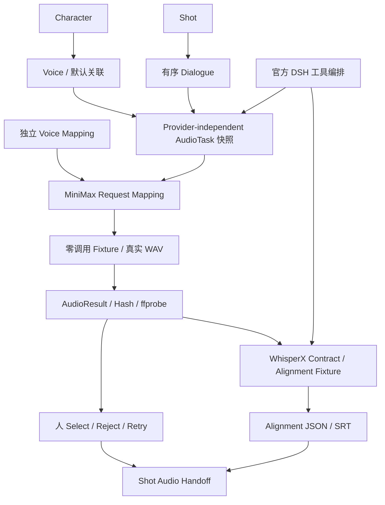

# A-07 契约、架构与能力证据

## 定向选型（2026-09-16）

首个 TTS Provider 选择 MiniMax，锁定 `speech-2.6-hd`。本轮需求是中文角色对白、明确的声音映射和可审查的 Delivery；官方同步接口可直接返回 WAV hex，映射成本小，不需改变 Character / Shot 核心模型。选择 2.6 的原因是官方 emotion 契约明确支持 whisper；没有为追逐新版改用不支持该选项的 2.8。

官方依据：[同步语音合成](https://platform.minimax.io/docs/api-reference/speech-t2a-http)、[系统声音 ID](https://platform.minimax.io/docs/faq/system-voice-id)、[错误码](https://platform.minimax.io/docs/api-reference/errorcode)。保存了官方页面 `minimax-official-page.html` 供审查折叠字段。固定声音 `Chinese (Mandarin)_Warm_Girl` 来自系统声音列表。

仅记录一个备选：[ElevenLabs Convert](https://elevenlabs.io/docs/api-reference/text-to-speech/convert)。其声音 ID 接口可满足外围映射，但本轮 MiniMax 中文 Delivery 契约更直接；这是工程适配选择，不是音质、成本或商业稳定性的实测排名。未实现第二家。

[MiniMax Voice Clone](https://platform.minimax.io/docs/api-reference/voice-cloning-clone) 是独立上传和克隆流程。参考音频保存在本地 Voice Asset，不将本地声音描述或 Reference 假装成已经克隆的系统 Voice。当前 clone mapping 明确拒绝执行。未验证声音克隆授权、音质或声音一致性。

## Audio Request / Response Mapping

Voice 的稳定 ID、描述、语言、Reference 与 Provider Voice ID 分离。`voice_mappings/<voice_id>.json` 保存外围映射；`character_voices/<character_id>.json` 保存默认 Voice，不修改旧 Character 文件。

AudioTask 包含 Dialogue / Character / Shot / Voice 快照、当次 text / delivery / speed / sample_rate / format。Provider-independent Task 不包含 MiniMax Voice ID。外围请求文件同时固定 model、voice_mapping 和官方 body，Job 保存 Task 和 Request SHA-256。

`POST https://api.minimax.io/v1/t2a_v2`：text → text；Voice Mapping → voice_setting.voice_id；delivery → emotion；speed → speed；固定非流式 stream=false、output_format=hex、32000 Hz、mono WAV。正式 HTTP 需要 Bearer Key；本轮请求只说明认证需求，不读取或保存 Key。

选用的官方接口是同步响应，没有远端异步 task ID。pending → processing → completed/failed 是本地 AudioJob 生命周期，成功响应 trace_id 单独保存，不伪造云端轮询接口。parse 检查 HTTP、base_resp.status_code、data.status=2、hex 和 WAV。失败保留错误，成功回收为可 ffprobe / ffplay 的实际文件。

Fixture Transport 无 HTTP 实现或网络降级路径，生成 4 秒低音量 PCM 测试音调，再包成官方成功响应结构。不是配音，也不模拟情绪声学效果。GUI 验收阻断 socket，尝试数为 0。官方文档 GET 不是生成调用。

可审查实例直接使用 [首次请求](gui-data/audio_tasks/7283dbd05b4642499c0556cefdee9026/provider_request.json)、[任务快照](gui-data/audio_tasks/7283dbd05b4642499c0556cefdee9026/task.json)，不复制一套伪示例。

## Alignment Contract

依据 [WhisperX 官方仓库](https://github.com/m-bain/whisperX) 及 [官方输出 Schema](https://github.com/m-bain/whisperX/blob/main/whisperx/schema.py)。本机当前 Python 未发现 whisperx，PATH 无 CLI，项目未发现可用外部执行配置；没有下载模型或安装 GPU 依赖。

薄 Adapter 输入实际 AudioResult 的相对路径和 SHA，约定由外部 worker 执行 transcribe_then_align；读取 segments / 可选 words / 可选 score。这里是项目 worker 契约，不声称 WhisperX 自带标准 HTTP 服务。当前只运行明确标记的 Fixture，未运行 ASR 或 forced alignment。

Fixture 转写独立固定为“这是音频测试。等待人工确认。”；Expected Text 保留当次 TTS Task 文本，原 Dialogue 文本另存在 Task 快照。时间落在 WAV 时长内；没有伪造 confidence。SRT 每句都有 [FIXTURE]，避免把音调占位文件对应的文本当成真实识别。

## 架构

## Open Source Integration Map

| 能力 | 决策 | 本轮实际边界 |
|---|---|---|
| DeepSeek Harness | INTEGRATE | 复用官方 0.1.5-rc.2，真实调用 prepare_dialogue_audio，无 LLM 调用 |
| FFmpeg / ffprobe / ffplay | USE | 现有安装，真实媒体解析和桌面播放，不自研编码 |
| Python wave | USE | 标准库生成 PCM Fixture，无新依赖 |
| WhisperX | CONTRACT-READY | 官方输出契约 + Fixture，模型未执行 |
| ComfyUI | 保留 INTEGRATE | A-06 图像 / 首帧契约不变，远端调用 0 |
| OTIO | LATER | 未接入，无 Timeline / Rough Cut |

## Resume Evidence

**Verified**：在既有 Character / Scene / Shot 生产数据上实现独立 Voice / Dialogue 和不可静默漂移的 AudioTask 快照；完成单一真实 TTS 官方契约映射与零调用 Fixture；实际 WAV 回收、ffprobe、桌面播放、人工 Reject / Retry / Select、重启持久化；WhisperX 输出契约、独立 Expected / Transcript、时间与 SRT 关联；官方 DSH 音频工具执行并保持 Human Gate；51 项测试通过。

**Unverified**：真实 TTS 音质、Voice Clone、跨镜头声音一致性、实际云端吞吐与成本、WhisperX 模型识别和对齐精度、字幕准确率、最终短剧音频质量。不能写成已经完成真实配音模型生产或效果 Benchmark。
