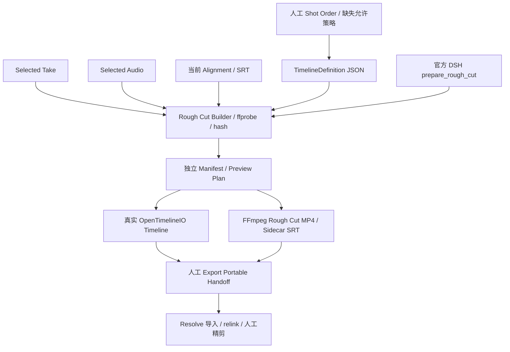

# A-08 Timeline 架构与交接边界

## 决策与官方依据

实际使用 OpenTimelineIO **0.18.1**，通过官方 PyPI 安装 CPython 3.13 / Windows x64 wheel（约 608 KB），无额外依赖或 Adapter 插件。此包支持 Python 3.9+，本项目仍使用 Python 3.11+。本机实际 Python 3.13.3。[官方安装](https://opentimelineio.readthedocs.io/en/latest/tutorials/quickstart.html) · [0.18.1 官方发行包](https://pypi.org/project/OpenTimelineIO/0.18.1/)。

使用标准 Timeline → Stack → Video / Audio Track → Clip / Gap；媒体以 ExternalReference 引用，时间使用 RationalTime / TimeRange，`.otio` 由官方 otio_json Adapter 读写。序列化前后使用 is_equivalent_to 验证。原始媒体 FPS / time_base / codec 保存在 metadata；时间线不是生产数据库。[官方架构](https://opentimelineio.readthedocs.io/en/latest/tutorials/architecture.html) · [时间范围](https://opentimelineio.readthedocs.io/en/latest/tutorials/time-ranges.html)。

OTIO 默认包含原生 JSON / 目录 / ZIP bundle Adapter，EDL、AAF、FCP XML 等属于额外插件，本轮不安装。[官方 Adapter 文档](https://opentimelineio.readthedocs.io/en/latest/tutorials/adapters.html)。目标选择 **DaVinci Resolve**：官方已有 OTIO 导入/导出路径，减少一次格式转换。[Resolve 18.5 官方功能指南](https://documents.blackmagicdesign.com/SupportNotes/DaVinci_Resolve_18.5_New_Features_Guide.pdf) 说明该功能起点；[Resolve 19 官方指南](https://documents.blackmagicdesign.com/SupportNotes/DaVinci_Resolve_19_New_Features_Guide.pdf) 继续记录 OTIO 导入选项。此处不是声称所有版本或所有 NLE 无损兼容。Premiere 留待后续，不做第二个适配器。

## 数据与状态

`timelines/<id>.json` 仅保存名称、显式 Shot ID 顺序、是否允许缺失音频 / 字幕和固定装配策略；默认不允许缺失。不是通过扫描顺序确定镜头顺序。Draft 无构建，Validate 得到 Ready / Blocked；构建输出独立 `rough_cut_builds/<build_id>/`，current 侧文件明确指向构建版本。

Builder 只读现有 Shot、Selected Take、Selected Audio、Alignment / SRT。视频未选择、缺失、损坏或错属时 Block，不猜候选。Dialogue 存在但未选音频时，只有人工允许才跳过并报告警告；不拿最新音频顶替。无 Dialogue 的 Shot 同样要明确允许静音。当前音频没有 Alignment 时可由人允许无字幕；来源错配或哈希损坏始终 Block。

Manifest 固定构建时生产事实，保存 Shot / Result / Task / Dialogue / Voice / Alignment IDs、媒体相对路径、哈希、ffprobe 元数据、source in/out、timeline frame in/out 和警告。执行 Preview / Export / Play 前重新解析当前事实并比对指纹；排序、Selection 或来源变化后返回 STALE，要求重建。修改 Manifest 本身也阻止使用。

## 时长和音频策略

- Timeline nominal rate 取人工顺序中第一个 Selected Video 的实际 avg_frame_rate，用 Fraction 保存（例如 24 或 30000/1001），不依赖手写 JSON duration。
- 每个 Shot 取实际视频 stream duration，向下量化到统一时间线完整帧；不足一帧 Block。source in 固定 0，source out 为实际采用时长。端点为半开区间。
- 混合 FPS 保留原始 rate / time_base，明确 Warning；Preview 使用 FFmpeg fps 滤镜重采样，不声称源规格相同。测试真实转换了一个 30 fps 源，验证 24 fps 输出。
- 视频驱动：对白按 Dialogue order 从 Shot 开头依序排放，不做创作性停顿判断。超出视频的部分截短并逐条警告；后续完全放不下的对白也报告 trim → 0。短音频余段静音。
- Preview 完全不取视频原音，只放 Selected Dialogue；缺失且人工允许的音频为静音。输出单声道 48 kHz AAC。不做混音、BGM、转场或调色。
- 字幕只来自当前 Selected Audio 的 Alignment，按相同音频 offset 移动、按采用范围裁切并合并为时间线 SRT。保留 [FIXTURE]，不烧录。语音内容仍是模拟转写，非识别结果。

## Working 与 Portable

Working Timeline 引用已有生产媒体，不复制源视频 / WAV。OTIO target_url 相对构建目录，可随完整 data 迁移；Manifest path 相对 data 根目录。assembly-plan.json 中 FFmpeg 命令含当次 resolved 绝对路径，仅用于审计，不作为迁移事实或可直接执行脚本。

人点击 Export Handoff 时，才创建独立 `handoffs/<id>/`。每份包按 SHA 去重复制使用到的两段视频、一段音频及其来源 SRT；不复制失败候选或全部任务历史。包内包括 timeline.otio、manifest.json、rough-cut.mp4、subtitles.srt、otio-inspection.json、media/、README.txt。媒体引用全部包内相对路径；manifest 保留 production_path 和稳定来源 ID 供回查，但不依赖旧机器路径进行媒体恢复。

Resolve 操作说明：在支持 OTIO 的版本导入 timeline.otio；必要时手动 relink 到 media/；明确将视频内嵌原音静音，仅使用 Selected Dialogue 音轨；从时间线 00:00:00 单独导入 subtitles.srt；复核顺序、帧率、音频长度和字幕后继续人工精剪。OTIO 自定义 metadata、音轨路由及字幕样式在 NLE 内不保证无损保留。

**已验证**：实际 OTIO 构建/回读/round-trip，真实 FFmpeg MP4，包复制后媒体引用、哈希、视频解析和字幕来源恢复。**未验证**：Resolve GUI 人工导入。没有为本轮安装 Resolve，也没有把文件验证写成 NLE 实机验收。

## 结构

DSH 只读保存的顺序、选择与策略，构建 OTIO 和 Preview，返回 human_review_required；不自动 Export，不修改 Timeline / Selected Video / Selected Audio。人通过调用入口授权装配；不存在后台自动创作或重排。

## Open Source Integration Map

| 项目 | 状态 | 本轮用途 |
|---|---|---|
| DeepSeek Harness | INTEGRATE | 复用官方运行时，真实执行粗剪工具，无 LLM 调用 |
| FFmpeg / ffprobe / ffplay | USE | 媒体验证、拼接、重采样、播放与解码核验 |
| OpenTimelineIO 0.18.1 | USE / INTEGRATE | 实际 Timeline / Clip / ExternalReference / JSON round-trip |
| ComfyUI | INTEGRATE / Contract + Fixture | 保留 A-06，真实调用 0 |
| WhisperX | CONTRACT-READY | 保留 A-07，不部署模型 |
| AI Movie Studio 2 | LEARN / EXTRACT WHEN NEEDED | 本轮无额外抽取必要 |

新增依赖只有 OTIO，Apache-2.0；通过官方 Python API 隔离在交接外围。无需它仍可读取 Voice / Dialogue / Shot 等 JSON 生产事实。未引入专业 Timeline 编辑器或新的基础设施。
